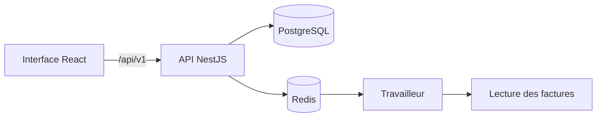

<p align="center">
  <picture>
    <source media="(prefers-color-scheme: dark)" srcset="apps/web/public/relnis-logo-fonce.svg">
    
  </picture>
</p>

# Relnis

**La gestion de stock simple et traçable pour les petites entreprises.**

Savoir ce qu'on a en stock, où, et quand recommander, avec une trace de chaque modification. Pensé d'abord pour les entrepreneurs et artisans du Québec, dont le matériel est réparti entre un entrepôt et des camions.

> **État : en développement — phase 0 (fondations).**

## Version 1

- Articles, codes-barres scannés par la caméra, plusieurs emplacements et transferts
- Entrées, sorties et ajustements, avec approbation au-delà d'un seuil
- Comptages d'inventaire, fournisseurs, bons de commande et réception
- Lecture des factures par IA (l'IA préremplit, l'humain valide)
- Tableau de bord et inventaire de fin d'exercice
- Plusieurs entreprises, 4 rôles : administrateur, gestionnaire, employé, comptable

## Principes

- Isolation stricte entre entreprises (API + sécurité au niveau des lignes de PostgreSQL).
- Le stock n'est jamais saisi à la main : il est la somme des mouvements, qui ne se modifient jamais.
- Rien ne se supprime ; journal d'audit en ajout seulement.
- Français par défaut, anglais disponible ; données réelles hébergées au Canada.

## Technologies

| Partie | Choix |
| --- | --- |
| API | NestJS 12, TypeScript, Prisma 7, PostgreSQL 18 |
| Interface | React 19, Vite, Tailwind CSS, shadcn/ui, react-i18next |
| Qualité | Vitest, oxlint, GitHub Actions |
| À venir | Redis + BullMQ, stockage S3, Railway et Vercel |



## Démarrer en local

Prérequis : Node.js 24, Docker.

```bash
npm install
cp apps/api/.env.example apps/api/.env
docker compose up -d                 # PostgreSQL, Redis et Mailpit (courriels : http://localhost:8025)
npm run db:deploy -w @relnis/api     # crée les tables et les rôles de l'API
npm run db:roles-dev -w @relnis/api  # ouvre la connexion de ces rôles (mots de passe locaux)
npm run db:generate -w @relnis/api
npm run start:dev -w @relnis/api     # API : http://localhost:3000/api/docs
npm run dev -w @relnis/web           # interface : http://localhost:5173
```

`npm run verifier` lance tout ce que vérifie le CI (lint, formatage, types, tests, build). Formater : `npm run format -w @relnis/api` (ou `-w @relnis/web`).

Détails : [apps/api](apps/api/README.md) · [apps/web](apps/web/README.md)

## Feuille de route

| Phase | Contenu |
| --- | --- |
| **0 — Fondations** (en cours) | Inscription, connexion, isolation, permissions, journal d'audit |
| 1 — Le cœur | Articles, emplacements, mouvements, approbations |
| 2 — Le terrain | Comptages, fournisseurs, commandes |
| 3 — L'IA | Lecture des factures |
| 4 — Vue d'ensemble | Tableau de bord, rapports |
| 5 — Finition | 2FA, administration de la plateforme |

## Conventions

- Travail sur une branche, puis pull request vers `main` (protégée, CI obligatoire).
- Commits [Conventional Commits](https://www.conventionalcommits.org/fr/), en français.
- Routes en français sans accents, au pluriel (`/api/v1/articles`) ; pas de suppression, des actions (`/archiver`).

## Licence

Tous droits réservés. Le code est public pour consultation ; toute réutilisation demande une autorisation.
