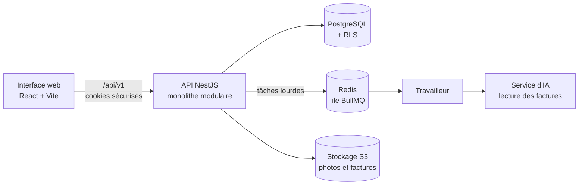

<p align="center">
  <picture>
    <source media="(prefers-color-scheme: dark)" srcset="apps/web/public/relnis-logo-fonce.svg">
    
  </picture>
</p>

# Relnis

**La gestion de stock simple et traçable pour les petites entreprises.**

Relnis permet de savoir ce qu'on a en stock, où, et quand recommander, avec une trace complète de chaque modification. L'application vise d'abord les entreprises sans caisse enregistreuse au Québec : entrepreneurs (plomberie, électricité, rénovation), artisans, ateliers et petits fabricants, dont le matériel est souvent réparti entre un entrepôt et des camions.

> **État : en développement, phase 0 (fondations).** Le squelette de l'API est en place ; les fonctions de gestion de stock arrivent aux phases suivantes.

## Ce que fera la version 1

- Articles, unités et conversions, codes-barres scannés avec la caméra du navigateur
- Plusieurs emplacements (entrepôt, magasin, camion) et transferts entre eux
- Entrées, sorties et ajustements, avec approbation au-delà d'un seuil
- Comptages d'inventaire à l'aveugle
- Fournisseurs, bons de commande et réception, même partielle
- Lecture des factures fournisseurs par IA : l'IA préremplit, l'humain valide
- Tableau de bord, alertes de stock bas et inventaire de fin d'exercice
- Plusieurs entreprises sur la même plateforme, avec 4 rôles : administrateur, gestionnaire, employé, comptable

Relnis n'est ni une caisse enregistreuse, ni un logiciel de comptabilité, ni un ERP : c'est un outil spécialisé dans le stock.

## Principes de conception

- **Isolation stricte entre entreprises** : vérifiée par l'API, puis par la sécurité au niveau des lignes (RLS) de PostgreSQL.
- **Le stock n'est jamais saisi à la main** : la quantité est la somme des mouvements validés. Un mouvement validé ne se modifie jamais ; une erreur se corrige par un mouvement inverse lié.
- **Rien ne se supprime** : on archive. Le journal d'audit n'accepte que des ajouts.
- **Séparation des tâches** : personne n'approuve son propre mouvement ni ne valide son propre comptage.
- **L'IA propose, l'humain valide** : l'application fonctionne entièrement sans elle.
- **Robuste** : transactions, stock négatif interdit par défaut, requêtes idempotentes (pas de doublon si le réseau coupe).
- **Bilingue et local** : français par défaut, anglais disponible, dates en UTC, données réelles hébergées au Canada (Loi 25).

## Architecture cible

Un monolithe modulaire : un seul serveur, découpé en modules indépendants (articles, mouvements, comptages, etc.).



## Technologies

| Rôle | Choix | État |
| --- | --- | --- |
| API | NestJS 12, TypeScript (mode strict), ES Modules | En place |
| Tests | Vitest | En place |
| Vérification du code | oxlint, Prettier | En place |
| Interface | React 19, TypeScript (mode strict), Vite, Tailwind CSS, shadcn/ui (Base UI), react-i18next | En place |
| Base de données | PostgreSQL, Prisma | Prévu |
| Tâches en arrière-plan | BullMQ, Redis | Prévu |
| Fichiers | Stockage compatible S3 (MinIO en local) | Prévu |
| Développement local | Docker Compose | Prévu |
| CI/CD | GitHub Actions, Railway (API), Vercel (interface) | Prévu |

## Structure du dépôt

Un seul dépôt (monorepo) avec les workspaces de npm :

```
relnis/
├── apps/
│   ├── api/          ← serveur NestJS
│   └── web/          ← interface React + Vite (logo et icônes dans web/public)
├── docs/             ← notes du projet (ex. règles d'utilisation du logo)
├── package.json      ← racine du monorepo (workspaces)
└── .nvmrc            ← version de Node du projet
```

## Démarrer en local

**Prérequis** : Node.js 24 (voir `.nvmrc`), npm 11 ou plus récent, Git. Docker sera nécessaire à partir de l'étape base de données.

```bash
git clone https://github.com/Rita-light/relnis.git
cd relnis
npm install
npm run start:dev -w @relnis/api   # l'API
npm run dev -w @relnis/web         # l'interface, dans un deuxième terminal
```

L'API démarre sur le port 3000 :

- <http://localhost:3000/api/v1> : toutes les adresses de l'API commencent par `/api/v1` ;
- <http://localhost:3000/api/docs> : la documentation Swagger, générée à partir du code, pour lire et essayer chaque adresse. Elle est désactivée en production.

`npm install` se lance toujours **à la racine** : il installe les dépendances de toutes les applications en une fois.

### Commandes utiles

| Commande | Rôle |
| --- | --- |
| `npm run start:dev -w @relnis/api` | Lance l'API en mode développement (redémarre à chaque modification) |
| `npm run test -w @relnis/api` | Tests unitaires |
| `npm run test:e2e -w @relnis/api` | Tests de bout en bout |
| `npm run lint -w @relnis/api` | Vérification du code |
| `npm run build -w @relnis/api` | Compilation dans `apps/api/dist` |
| `npm run dev -w @relnis/web` | Lance l'interface sur <http://localhost:5173> |
| `npm run lint -w @relnis/web` | Vérification du code de l'interface |
| `npm run build -w @relnis/web` | Construction de l'interface dans `apps/web/dist` |

`-w` (workspace) exécute la commande dans une application précise, sans changer de dossier.

## Feuille de route

Chaque phase se termine par une version démontrable, mise en ligne.

| Phase | Contenu | État |
| --- | --- | --- |
| 0 — Fondations | Connexion, entreprises, isolation, permissions, journal d'audit | En cours |
| 1 — Le cœur | Paramètres, articles, emplacements et transferts, mouvements, approbations, invitations | À venir |
| 2 — Le terrain | Comptages, fournisseurs, bons de commande, réception | À venir |
| 3 — L'IA | Lecture des factures par photo, en arrière-plan | À venir |
| 4 — La vue d'ensemble | Tableau de bord, notifications, rapports | À venir |
| 5 — La finition | Double authentification, grille des permissions, administration de la plateforme | À venir |

## Conventions

- **Branches** : `main` reste stable ; le travail se fait sur une branche (ex. `phase-0/mise-en-place`), puis passe par une pull request.
- **Commits** : [Conventional Commits](https://www.conventionalcommits.org/fr/) (`feat`, `fix`, `chore`, `docs`), description en français.
- **API** : adresses sous `/api/v1`, noms au pluriel en français sans accents (`/articles`, `/bons-commande`). Pas de suppression : des actions (`/archiver`, `/annuler`).
- **Code** : ES Modules, donc les imports relatifs se terminent par `.js`.
- **Fins de ligne** : LF partout (voir `.gitattributes`).

## Licence

Aucune licence : tous droits réservés. Le code est public pour être consulté, mais sa réutilisation demande une autorisation.
